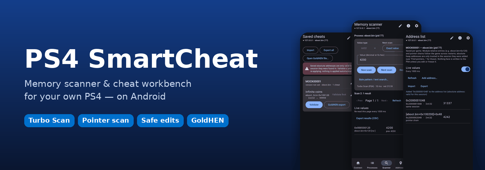
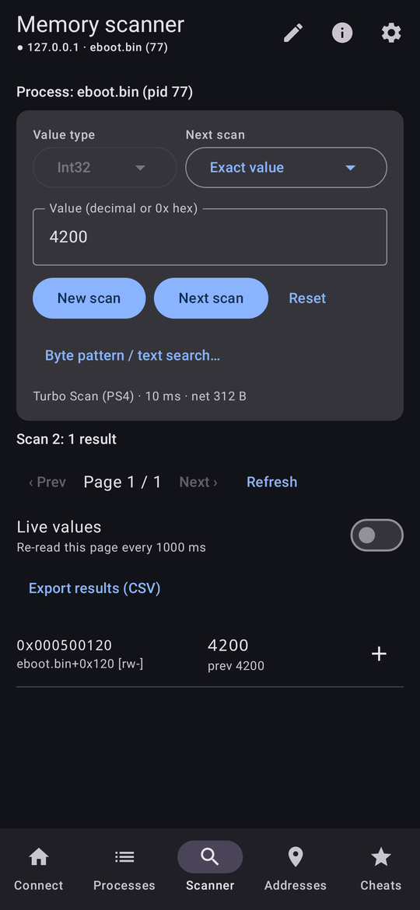
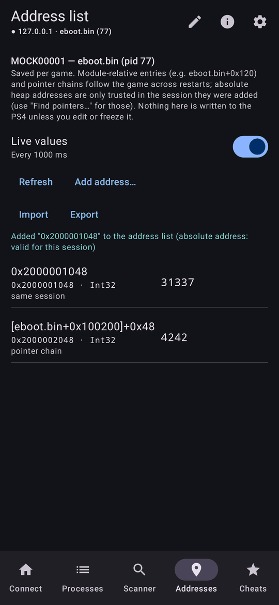
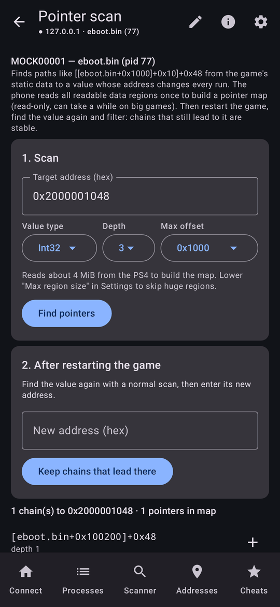
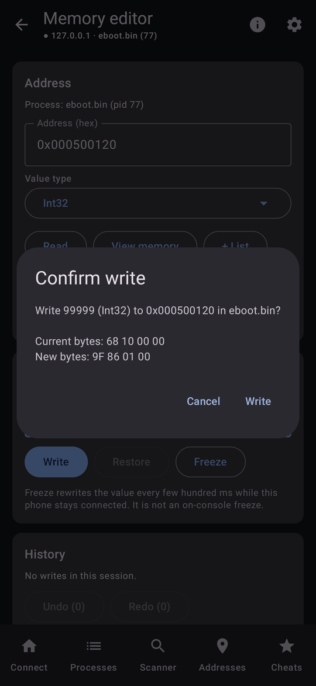

<div dir="rtl">

<div align="center">



# PS4 SmartCheat

**ماسح ذاكرة ومنصة غشّ احترافية لجهاز PS4 الخاص بك (المعدّل) — تعمل من هاتفك الأندرويد.**

[](https://github.com/Hm589158/ps4-SmartCheat/actions/workflows/ci.yml)
[](https://github.com/Hm589158/ps4-SmartCheat/releases)
[](#التثبيت)
[](LICENSE)

[English](README.md) · **العربية**

</div>

---

يتصل PS4 SmartCheat عبر شبكتك المحلية بـ **ps4debug-NG** (أو ps4debug الكلاسيكي من GoldHEN) ويحوّل الهاتف إلى
أداة ذاكرة متكاملة. يمكنك:

- العثور على القيمة في ثوانٍ، بعمليات بحث تجري على الجهاز نفسه.
- تعديلها بأمان مع التحقق والتراجع.
- الاحتفاظ بها بعد إعادة تشغيل اللعبة، بعناوين نسبية وسلاسل مؤشرات.
- حفظها كغش بصيغة GoldHEN.

كل ذلك للألعاب غير المتصلة بالإنترنت والبرامج المنزلية (homebrew) على جهازك أنت.

<div align="center">
<table>
  <tr>
    <td align="center"><br><sub><b>بحث Turbo على الجهاز</b></sub></td>
    <td align="center"><br><sub><b>قائمة العناوين بقيم حية</b></sub></td>
    <td align="center"><br><sub><b>البحث عن المؤشرات</b></sub></td>
    <td align="center"><br><sub><b>كل كتابة بتأكيد</b></sub></td>
  </tr>
</table>
<sub>الصور مأخوذة من الاختبارات الآلية مع خادم ps4debug-NG محاكى (وليس من جهاز PS4).</sub>
</div>

## التثبيت

1. نزّل أحدث ملف APK من صفحة **[Releases](https://github.com/Hm589158/ps4-SmartCheat/releases)** على هاتفك
   (أندرويد 8.0 أو أحدث)، واسمح بـ "تثبيت التطبيقات غير المعروفة" للمتصفح أو مدير الملفات.
2. اختياري: تحقق من سلامة الملف بـ `SHA256SUMS.txt` المرفق بالإصدار.

- **النسخ التجريبية** (`…-test.apk`): تُنشر تلقائيًا بعد نجاح كل الفحوصات، وتُثبَّت باسم `com.ps4smartcheat.app.debug`.
- **النسخ الرسمية الموقّعة** (`PS4-SmartCheat-v1.2.3.apk`): تُثبَّت باسم `com.ps4smartcheat.app`. طريقة تفعيلها موضحة في
  [docs/RELEASE_SIGNING.md](docs/RELEASE_SIGNING.md).

## البدء السريع

1. **على PS4:** شغّل GoldHEN، ثم حمّل **ps4debug-NG** (الموصى به)، ثم شغّل اللعبة.
2. **في التطبيق:** أدخل عنوان IP المحلي للجهاز (المنفذ `744`) ← **Connect**. تُكتشف اللعبة وتُختار تلقائيًا.
3. **ابحث:** Scanner ← اكتب القيمة الظاهرة (مثل الذخيرة `30`) ← **First scan**. غيّرها في اللعبة ثم ← **Next scan**.
4. **عدّل:** الإعدادات ← فعّل تعديل الذاكرة ← اضغط النتيجة ← القيمة الجديدة ← **Write** ← أكّد.
5. **احتفظ:** اضغط **+** لإضافتها إلى قائمة عناوين اللعبة. للقيم التي يتغير عنوانها في كل تشغيل استخدم "Find pointers…".

دليل الاستخدام داخل التطبيق (زر ⓘ) يشرح كل خطوة.

## أبرز الميزات

- **بحث سريع:** ثلاث طرق تُختار تلقائيًا: Turbo على الجهاز، ثم البحث على الخادم، ثم البحث على الهاتف.
  تدعم كل أنواع الأرقام وأوضاع: قيمة محددة، أكبر من، أصغر من، بين قيمتين، قيمة مجهولة، زادت، نقصت، تغيرت.
- **بحث بنمط البايتات والنصوص:** (AOB) مع `??`، ونصوص ASCII وUTF-16.
- **تعديل آمن:** الوضع الافتراضي للقراءة فقط. كل كتابة تعرض البايتات الحالية والجديدة، وتحتاج تأكيدًا، وتُتحقق
  بقراءة جديدة. يوجد استعادة القيمة الأصلية، وتراجع وإعادة (Undo/Redo)، وتجميد القيم.
- **قائمة عناوين لكل لعبة:** بقيم حية، وعناوين نسبية تبقى صحيحة بعد إعادة التشغيل.
- **البحث عن المؤشرات:** للقيم التي يتغير عنوانها، مع تصفية السلاسل بعد إعادة تشغيل اللعبة.
- **مكتبة الغش:** تصدير واستيراد ملفات GoldHEN، ولا يُفعَّل أي غش إلا إذا طابقت الذاكرة قيم "off" تمامًا.
- **أدوات إضافية:** عارض ذاكرة مع تعديل البايتات، وشاشة تشخيص الاتصال، وسجل أحداث قابل للتصدير، وتصميم للأجهزة اللوحية.

## الأمان والنطاق

> [!IMPORTANT]
> للألعاب **غير المتصلة بالإنترنت** وعلى **جهازك أنت** فقط. لا غش في الألعاب الجماعية أو الأونلاين، ولا تجاوز
> لأنظمة مكافحة الغش أو الحماية، ولا تعديل لملفات الحفظ أو ذاكرة النواة.

- ps4debug **بدون مصادقة**: استخدمه فقط على شبكة محلية موثوقة. التطبيق يرفض العناوين غير المحلية افتراضيًا.
- لا تتبّع، ولا حسابات، ولا خدمات سحابية.
- لا تُعاد أي كتابة تلقائيًا، لا بعد إعادة الاتصال ولا بعد إعادة تشغيل اللعبة.

## التوافق

- **FW 11.00 + GoldHEN + ps4debug-NG 1.3.3:** المسار الأساسي يعمل بحسب تجربة صاحب المشروع (الاتصال، والمصادقة،
  وقائمة العمليات، وبحث Turbo، والتضييق، والكتابة).
- **الميزات المضافة منذ 0.8:** مختبرة مع الخادم المحاكى، ونرحب بنتائج التجربة على الجهاز.

التفاصيل في [docs/COMPATIBILITY.md](docs/COMPATIBILITY.md).

## البناء من المصدر

```bash
cd android
./gradlew :core:test          # اختبارات المنطق الأساسي (لا تحتاج Android SDK)
./gradlew :app:assembleDebug  # بناء ملف APK
./gradlew :mockserver:run --args="7440"   # جهاز PS4 محاكى لتجربة التطبيق بدون جهاز
```

بقية التوثيق (بالإنجليزية): [الواجهة الإنجليزية](README.md#documentation).

## الترخيص

[MIT](LICENSE). PlayStation وPS4 علامتان تجاريتان لشركة Sony Interactive Entertainment، وهذا المشروع غير تابع لها.

</div>
