<div align="center">

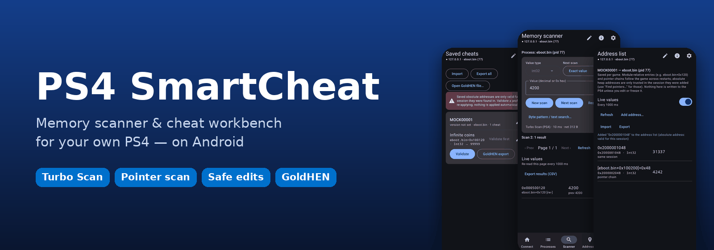

# PS4 SmartCheat

**A memory scanner and cheat workbench for your own jailbroken PlayStation 4 — running on your Android phone.**

[](#status)
[](https://github.com/Hm589158/ps4-SmartCheat/releases)
[](https://github.com/Hm589158/ps4-SmartCheat/actions/workflows/ci.yml)
[](https://github.com/Pharaoh2k/ps4debug-NG)
[](#required-downloads)
[](LICENSE)

[Downloads](#required-downloads) · [Setup](#setup-in-5-steps) · [Features](#features) · [Status](#status) · [Build](#building-from-source) · [Credits](#credits-and-licenses)

</div>

---

PS4 SmartCheat connects over your local network to **ps4debug-NG** and turns the phone into a complete memory tool:
find a value in seconds with scans that run *on the console*, edit it safely with verification and undo, keep it across
game restarts with module-relative addresses and pointer chains, and package it as a GoldHEN cheat — for offline games
and homebrew on hardware you own.

## Required downloads

| | What | Where |
|:-:|---|---|
| 📱 | **PS4 SmartCheat** — the Android app (APK, Android 8.0+) | **[Releases](https://github.com/Hm589158/ps4-SmartCheat/releases)** — take the newest build |
| 🎮 | **ps4debug-NG** — the debugger payload that runs on the PS4 | **[Official project](https://github.com/Pharaoh2k/ps4debug-NG)** · **[Releases](https://github.com/Pharaoh2k/ps4debug-NG/releases/latest)** |
| 🔓 | **GoldHEN** — homebrew enabler on the jailbroken console | [GoldHEN](https://github.com/GoldHEN/GoldHEN) |

> [!IMPORTANT]
> **ps4debug-NG is required for scanning and editing.** It is the debugger the app is built and tested for: the app
> authenticates with it automatically and uses its Turbo and server-side scans. The classic ps4debug payload (for example
> [GoldHEN/ps4debug](https://github.com/GoldHEN/ps4debug)) only works in an untested compatibility mode and is not supported.

**The ps4debug-NG payload file.** Each ps4debug-NG release ships one ready-to-send `.bin` payload. At the time of
writing the latest is **v1.3.4**:
[`ps4debug-ng_v1.3.4_release_2026-11-05.bin`](https://github.com/Pharaoh2k/ps4debug-NG/releases/download/1.3.4/ps4debug-ng_v1.3.4_release_2026-11-05.bin)
(3.03 MB, SHA-256 `8bfe0507972718e6078778c5f9c44d84293197c0547239ab4227bdb351299b3e`). The file name changes with every
release, so check the [latest release](https://github.com/Pharaoh2k/ps4debug-NG/releases/latest) for newer versions. You
can also build it from source with the project's `build.sh`. The output is `ps4debug-ng.bin`.

## Setup in 5 steps

1. **Jailbreak and start GoldHEN** on the PS4 with the method for your firmware.
2. **Load ps4debug-NG.** Send the `.bin` to your jailbreak's payload loader. The ps4debug-NG README names ports
   **9020 or 9021**, depending on the jailbreak. Example from a computer on the same network:
   ```bash
   nc <PS4-IP> 9020 < ps4debug-ng_v1.3.4_release_2026-11-05.bin
   ```
   (or use your favourite payload sender app). The console shows the notification **"ps4debug-NG v1.3.4 by Pharaoh2k"**
   when it is running and listening on port **744**.
3. **Start the game** you want to inspect (offline / single-player).
4. **Connect the app.** Phone on the same Wi-Fi/LAN → PS4 SmartCheat → enter the PS4's local IP, port **744** →
   **Connect**. The app shows *ps4debug-NG*, *Scan auth: granted* and selects the running game automatically.
5. **Scan and edit.** Scanner → enter the value you see (e.g. ammo `30`) → **First scan** → change it in the game →
   **Next scan** until a few results remain. Settings → *Enable memory editing* → tap the result → new value →
   **Write** → confirm. Tap **+** to keep it in the game's address list.

> [!TIP]
> The PS4's IP address is under *Settings → Network → View Connection Status*. If **Connect** fails, check that the
> ps4debug-NG notification appeared, and use *Settings → Connection diagnostics* in the app. The in-app guide (ⓘ) covers
> every screen.

<div align="center">
<table>
  <tr>
    <td align="center">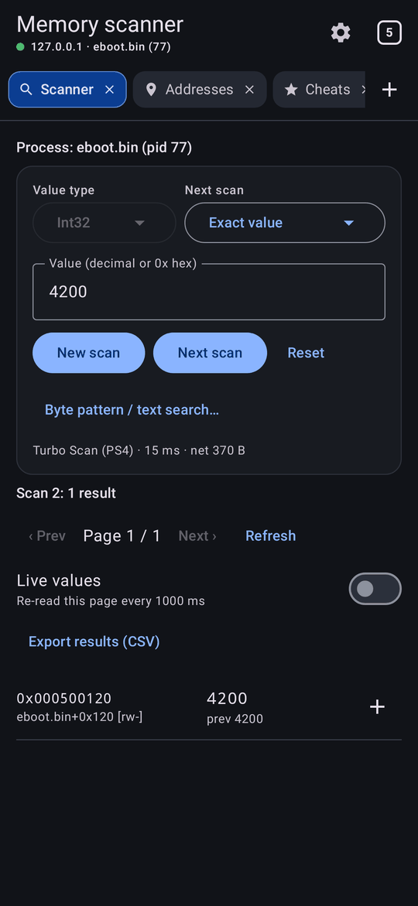<br><sub><b>Turbo Scan on the PS4</b></sub></td>
    <td align="center">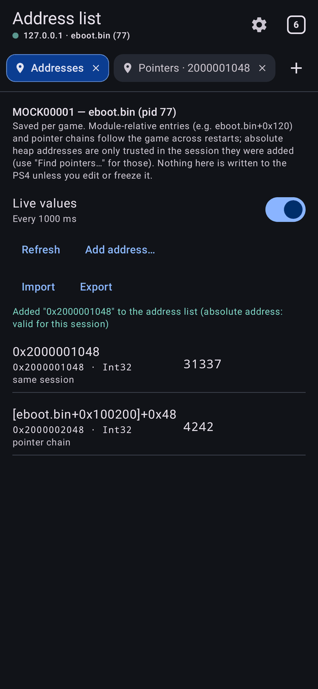<br><sub><b>Address list</b></sub></td>
    <td align="center">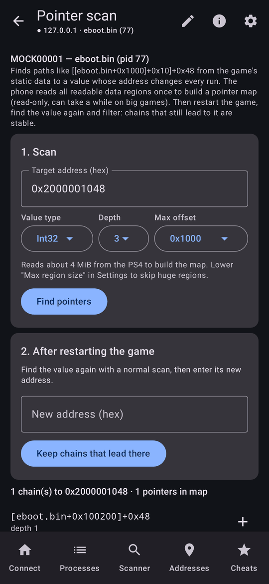<br><sub><b>Pointer scan</b></sub></td>
    <td align="center">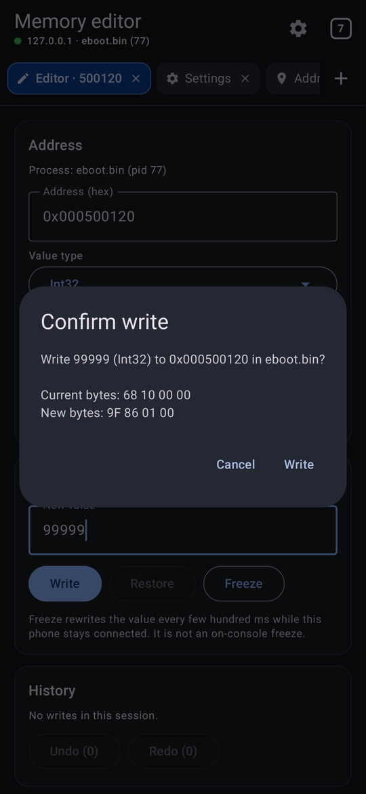<br><sub><b>Confirmed writes</b></sub></td>
  </tr>
  <tr>
    <td align="center">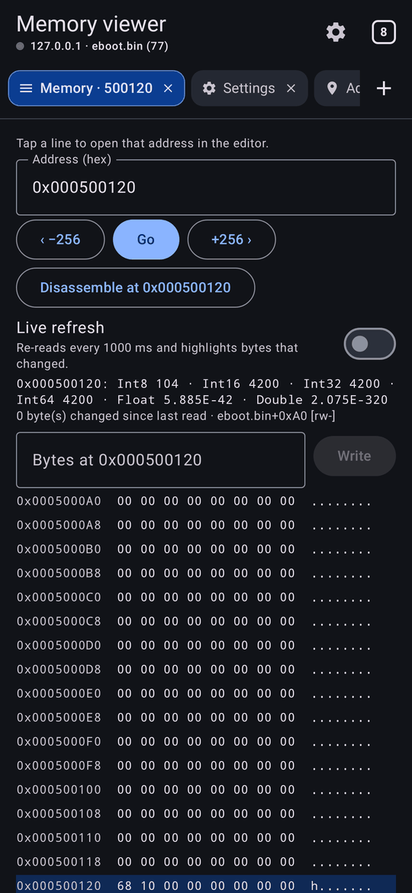<br><sub><b>Hex viewer</b></sub></td>
    <td align="center">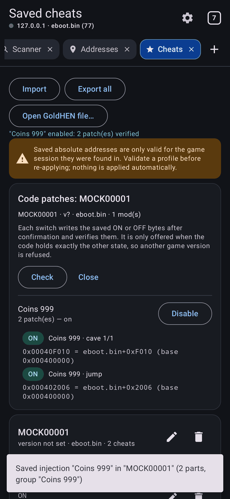<br><sub><b>Cheats · GoldHEN</b></sub></td>
    <td align="center">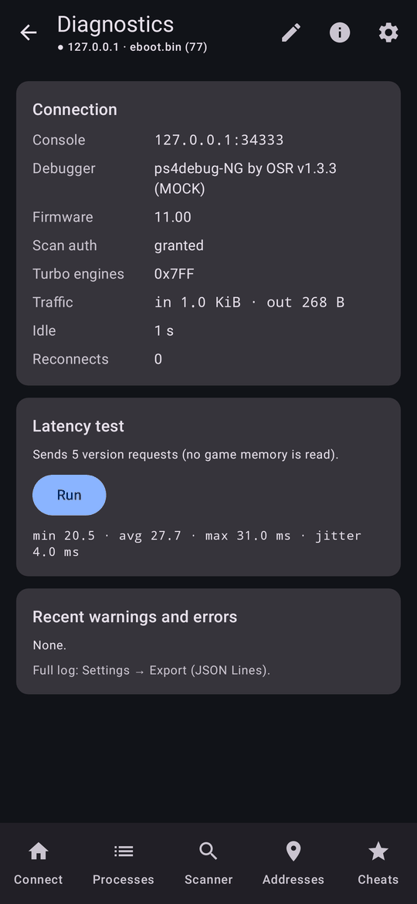<br><sub><b>Diagnostics</b></sub></td>
    <td align="center">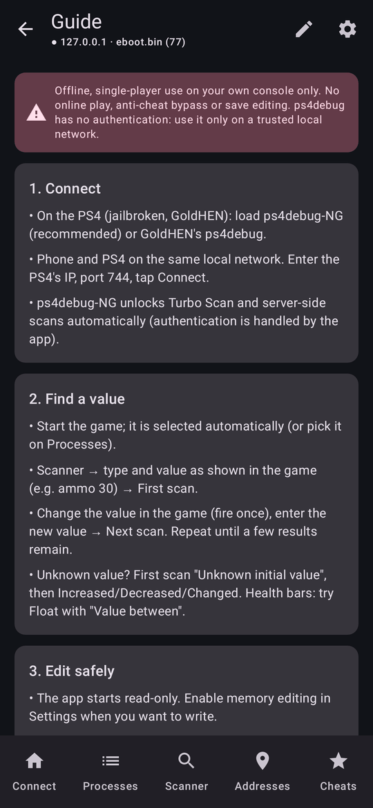<br><sub><b>In-app guide</b></sub></td>
  </tr>
</table>
<details><summary><b>Tablet layout</b></summary><br>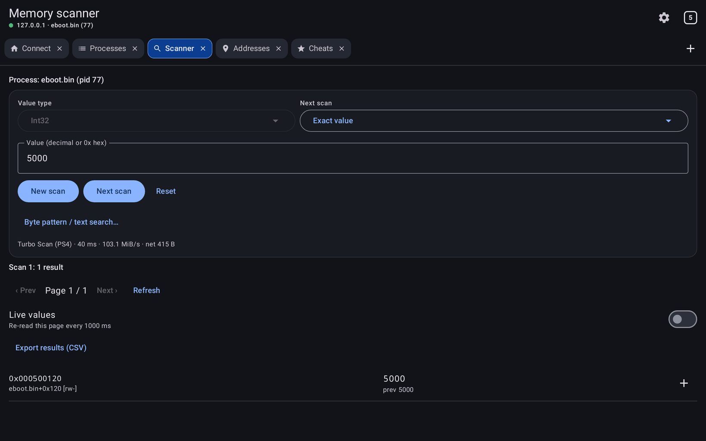</details>
<sub>Screenshots from the automated UI tests, which run against a simulated ps4debug-NG server (not a real PS4).</sub>
</div>

## Features

<table>
<tr><td width="50%" valign="top">

**🔎 Fast scanning**
- **Turbo Scan** and **server-side scan** run on the PS4. The app picks them automatically and falls back to scanning on
  the phone ([benchmark](docs/PERFORMANCE.md))
- Int8 – Int64, Float, Double · exact, bigger/smaller, between, unknown initial, increased/decreased (by),
  changed/unchanged
- Byte-pattern (AOB, `??` wildcards) and text search
- Live progress, MiB/s and network traffic. Sessions resume after an app restart

</td><td width="50%" valign="top">

**🛡️ Safe editing**
- Read-only until you enable editing. It turns off again every time the app starts
- Every write shows the current → new bytes, needs your confirmation, and is checked by reading it back
- Restore originals, confirmed **undo/redo**, freeze while connected
- System processes and code regions are blocked unless you allow them

</td></tr>
<tr><td valign="top">

**📌 Keep what you found**
- Per-game **address list** with live values, freeze and edit
- Addresses stored relative to the game executable survive restarts
- **Pointer scan** for values that move every run: filter the chains after a restart
- Export/import address lists

</td><td valign="top">

**🎮 Cheats and tools**
- Cheat library with per-game profiles and JSON import/export
- **GoldHEN** cheat export. Import enables a mod only if the game's memory matches the mod's original (`off`) bytes
- Hex viewer with byte patches, game detection, automatic reconnect
- Connection diagnostics, exportable event log, tablet layout

</td></tr>
<tr><td valign="top">

**🧩 Assembly ON/OFF cheats**
- **Disassembler** with addresses, `eboot.bin+offset`, bytes and read/write/branch markers; follow branches
- Type new instructions (`nop`, `mov eax, 999` …): the **PS4 assembles them** (ps4debug-NG's Keystone) at that address
- Whole instructions are replaced and NOP-padded; preview of ON/OFF bytes and warnings before anything is written
- **ON (1) / OFF (0)** with confirmation and read-back; save to the library and **export to GoldHEN** — switch it from
  the GoldHEN menu without the phone

</td><td valign="top">

**🔬 Find what writes / accesses**
- Hardware **watchpoint** through ps4debug-NG's debugger: every instruction that writes (or reads) an address, with
  hit count, thread and registers; open it in the disassembler
- **Check after restart**: address list, pointers, value cheats and code patches; moved code is found again by its
  signature. **Pointer candidates** ranked by how often they survive restarts
- Needs the PS4 to reach the phone on port 755 (root, or a small relay on a PC — [guide](docs/WATCHPOINTS.md))

</td></tr>
</table>

## Status

**Beta (1.0.0-beta).** Feature-complete and passing every automated check on each commit. It is now being verified on
real consoles.

| Setup | Result |
|---|---|
| FW 11.00 · GoldHEN · ps4debug-NG **1.3.3** | **Reported working by the project owner:** connect, authentication, process list, Turbo Scan, next scans, writing a value in a game |
| Same setup — tools added since 0.8 (address list, pointer scan, pattern search, byte patches, undo/redo, GoldHEN import, diagnostics) | Verified end to end against the simulated server. **Hardware reports wanted** |
| Assembly ON/OFF patches, assembler, reference search, watchpoints (What writes / accesses), session check | Implemented from the ps4debug-NG **1.3.4** source and verified against the simulated server only. **Hardware reports wanted** |
| ps4debug-NG **1.3.4** (current upstream) and other firmware supported by ps4debug-NG | Expected to work (same protocol). Not yet reported |
| Classic / GoldHEN ps4debug | Not supported (untested compatibility mode only) |

Tested something? Please file a **[hardware test report](https://github.com/Hm589158/ps4-SmartCheat/issues/new?template=hardware_report.yml)**.
Details are in [docs/COMPATIBILITY.md](docs/COMPATIBILITY.md).

**Builds on the Releases page:** the newest beta build is always the **Latest** release, named
`PS4-SmartCheat-v1.0.0-beta.<build>.apk` and published automatically after every green CI run on `main`. They are debug-signed by CI (package `com.ps4smartcheat.app.debug`).
Releases signed with the project key will use `com.ps4smartcheat.app` ([signing](docs/RELEASE_SIGNING.md)). Verify a
download with its `SHA256SUMS.txt`.

## How it works

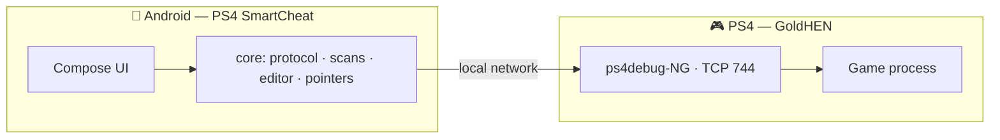

**Turbo Scan** keeps the candidates on the console, so only the matches travel over Wi-Fi: kilobytes instead of tens of
megabytes per scan. Every protocol command the app uses was checked against the ps4debug-NG source and is documented in
[docs/PROTOCOL.md](docs/PROTOCOL.md). ps4debug has no authentication, so use it only on a trusted home network. The app
refuses non-local addresses by default and sends nothing anywhere else.

## Building from source

```bash
cd android
./gradlew :core:test                      # 140+ JVM tests (no Android SDK needed)
./gradlew :app:testDebugUnitTest          # end-to-end UI journeys (Android SDK)
./gradlew :app:assembleDebug              # debug APK
./gradlew :mockserver:run --args="7440"   # simulated PS4 to try the app without a console
```

JDK 17+, Android SDK for `:app`. Gradle 8.14.3, AGP 8.11.1, Kotlin 2.2.21, Compose BOM 2025.08.00, min SDK 26,
target SDK 36.

CI runs on every push:
- core and mock-server tests and the scan benchmark;
- UI journeys, with screenshots on the [`ci-screenshots`](https://github.com/Hm589158/ps4-SmartCheat/tree/ci-screenshots) branch;
- lint and the APK build.

<details>
<summary><b>Project layout</b></summary>

```
android/core/        protocol client, scanners, editor, pointer scan, address list, cheats (pure Kotlin)
android/mockserver/  independent ps4debug-NG emulation for tests and manual trials
android/app/         Jetpack Compose UI and end-to-end tests
docs/                protocol, architecture, testing, performance, compatibility, roadmap, signing
```
</details>

## Documentation

[Changelog](CHANGELOG.md) · [Protocol](docs/PROTOCOL.md) · [Architecture](docs/ARCHITECTURE.md) · [Testing](docs/TESTING.md) ·
[Performance](docs/PERFORMANCE.md) · [Compatibility](docs/COMPATIBILITY.md) · [Roadmap](docs/ROADMAP.md) ·
[Release signing](docs/RELEASE_SIGNING.md) · [Watchpoints & relay](docs/WATCHPOINTS.md) · [Contributing](CONTRIBUTING.md) · [Security](SECURITY.md)

## Credits and licenses

- **[ps4debug-NG](https://github.com/Pharaoh2k/ps4debug-NG)** — the debugger payload this app depends on. It is a
  clean-room rewrite by **OSR (OpenSourcereR)**, published by **Pharaoh2k**, and licensed under **GPL-3.0**. It builds on
  **jogolden**'s original [ps4debug](https://github.com/jogolden/ps4debug) and on **Ctn & SiSTRo**'s ps4debug v1.1.19.
- [PS4CheaterNeo](https://github.com/avan06/PS4CheaterNeo) by **avan06**: client reference and GoldHEN cheat format.
- [GoldHEN](https://github.com/GoldHEN/GoldHEN) and its [cheat repository](https://github.com/GoldHEN/GoldHEN_Cheat_Repository).
- [iced-x86](https://github.com/icedland/iced) (MIT) — x86-64 decoder used by the disassembler.

**This repository does not bundle or redistribute ps4debug-NG.** Download it from its official releases. If you
redistribute it, follow its GPL-3.0 terms:
- keep the license and attribution, including the credit to the original authors;
- provide the complete corresponding source for any binary you distribute, modified or not.

PS4 SmartCheat itself is released under the [GNU General Public License v3.0](LICENSE) (GPL-3.0). PlayStation and PS4 are trademarks of Sony Interactive
Entertainment. This project is not affiliated with or endorsed by Sony.
