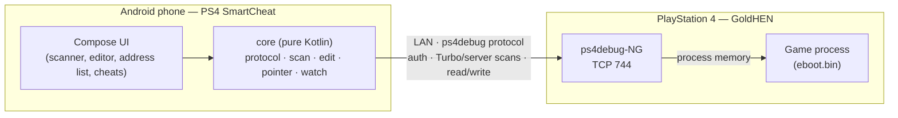

<div align="center">


# PS4 SmartCheat

**A memory scanner and cheat workbench for your own jailbroken PlayStation 4 — running on your Android phone.**

[](https://github.com/Hm589158/ps4-SmartCheat/actions/workflows/ci.yml)
[](https://github.com/Hm589158/ps4-SmartCheat/releases)
[](#install)
[](docs/ARCHITECTURE.md)
[](docs/PROTOCOL.md)
[](LICENSE)

[Install](#install) · [Quick start](#quick-start) · [Features](#features) · [How it works](#how-it-works) · [Build](#building-from-source) · [Docs](#documentation)

</div>

---

PS4 SmartCheat connects over your local network to **ps4debug-NG** (or GoldHEN's classic ps4debug) and turns the phone
into a complete memory tool: find a value in seconds with scans that run *on the console*, edit it safely with
verification and undo, keep it across game restarts with module-relative addresses and pointer chains, and package it
as a GoldHEN cheat — for offline games and homebrew on hardware you own.

<div align="center">
<table>
  <tr>
    <td align="center"><br><sub><b>Turbo Scan on the PS4</b></sub></td>
    <td align="center"><br><sub><b>Address list with live values</b></sub></td>
    <td align="center"><br><sub><b>Pointer scan</b></sub></td>
    <td align="center"><br><sub><b>Every write confirmed</b></sub></td>
  </tr>
  <tr>
    <td align="center"><br><sub><b>Hex viewer and byte patches</b></sub></td>
    <td align="center"><br><sub><b>Cheat library · GoldHEN</b></sub></td>
    <td align="center"><br><sub><b>Connection diagnostics</b></sub></td>
    <td align="center"><br><sub><b>In-app guide</b></sub></td>
  </tr>
</table>
<br>
<sub>Tablet layout. Screenshots come from the automated UI tests against the mock ps4debug-NG server (not a PS4).</sub>
</div>

## Install

1. Download the newest APK from **[Releases](https://github.com/Hm589158/ps4-SmartCheat/releases)** on your phone
   (Android 8.0 or newer) and allow *Install unknown apps* for your browser or file manager.
2. Optional: verify it with the release's `SHA256SUMS.txt` (`sha256sum -c SHA256SUMS.txt`).

| Build | File name | Package | Signed with |
|---|---|---|---|
| Test build (pre-release, published after every green CI run on `main`) | `PS4-SmartCheat-v1.2.3-build.N-test.apk` | `com.ps4smartcheat.app.debug` | CI debug key |
| Release | `PS4-SmartCheat-v1.2.3.apk` | `com.ps4smartcheat.app` | owner's release key ([how](docs/RELEASE_SIGNING.md)) |

## Quick start

1. **PS4:** jailbreak with GoldHEN, load the **ps4debug-NG** payload (recommended), start the game.
2. **App:** enter the PS4's local IP (port `744`) → **Connect**. The running game is detected and selected automatically.
3. **Find:** Scanner → type the value you see (e.g. ammo `30`) → **First scan** → change it in the game → **Next scan**.
4. **Edit:** Settings → *Enable memory editing* → tap the result → enter the new value → **Write** → confirm.
5. **Keep:** tap **+** to add it to the game's address list; use *Find pointers…* for values that move every run.

The in-app guide (ⓘ in the top bar) covers every step, including troubleshooting.

## Features

<table>
<tr><td width="50%" valign="top">

**🔎 Fast scanning**
- Three backends chosen automatically: **Turbo Scan** and **server-side scan** on the PS4 (ps4debug-NG, automatic
  `CMD_PROC_AUTH`), falling back to an optimized **chunked scan on Android** ([measurements](docs/PERFORMANCE.md))
- Int8 – Int64, Float, Double · exact, bigger/smaller than, value between, unknown initial, increased/decreased
  (by), changed/unchanged
- Live progress, elapsed time, MiB/s, network bytes and the backend used
- Byte-pattern (AOB, `??` and nibble wildcards) and text search (ASCII/UTF-8, UTF-16LE)
- Sessions saved after each step and resumable after an app restart

</td><td width="50%" valign="top">

**🛡️ Safe editing**
- Read-only by default; editing resets to off on every start
- Every write shows current → new bytes, needs confirmation and is verified by a fresh read
- Restore originals, confirmed **undo/redo**, freeze while connected
- Raw byte patches in the hex viewer under the same rules
- System processes and code regions blocked unless explicitly allowed

</td></tr>
<tr><td valign="top">

**📌 Keep what you found**
- Per-game **address list** (by title ID) with live values, freeze and edit
- Module-relative entries (`eboot.bin+0x…`) that survive restarts
- **Pointer scan**: pointer map built on the phone (spilled to disk for big games), backward search to static data,
  filter chains after a restart, pointer entries followed on every read
- Export/import address lists as JSON

</td><td valign="top">

**🎮 Cheats and tools**
- Cheat library with per-game profiles, validation before re-applying, JSON import/export
- **GoldHEN** cheat export, and import that enables a mod only when memory matches its `off` bytes
- Hex/ASCII memory viewer with live change highlighting
- Game detection, exit/restart handling, automatic reconnection
- Connection diagnostics, structured log export (JSON Lines), tablet layout

</td></tr>
</table>

## How it works



- **Turbo Scan** keeps candidates on the console: only matches travel over Wi-Fi (kilobytes instead of tens of
  megabytes per scan in the [benchmark](docs/PERFORMANCE.md)).
- Every protocol command used is verified against upstream source and documented in [docs/PROTOCOL.md](docs/PROTOCOL.md).
- The `core` module has no Android dependencies and is tested against an independent mock ps4debug-NG server over real TCP.

## Compatibility

| Console | Debugger | Status |
|---|---|---|
| FW 11.00 · GoldHEN | ps4debug-NG 1.3.3 | Core flow **reported working by the owner**: connect, auth, process list, Turbo Scan, refines, write in a game |
| FW 11.00 · GoldHEN | ps4debug-NG 1.3.3 | Features since 0.8 (address list, pointer scan, patterns, undo/redo, GoldHEN import, diagnostics): mock-tested, hardware feedback welcome |
| Other firmware / classic ps4debug | — | Expected to work in compatibility mode (Android-side scanning); not verified |

Details and how to report results: [docs/COMPATIBILITY.md](docs/COMPATIBILITY.md).

## Building from source

```bash
cd android
./gradlew :core:test                      # 140+ JVM tests — no Android SDK needed
./gradlew :app:testDebugUnitTest          # Robolectric end-to-end UI journeys (needs an Android SDK)
./gradlew :app:assembleDebug              # debug APK
./gradlew :mockserver:run --args="7440"   # simulated PS4 for trying the app without a console
```

Requirements: JDK 17+, Android SDK (for `:app`). Toolchain: Gradle 8.14.3 (wrapper), AGP 8.11.1, Kotlin 2.2.21,
Compose BOM 2025.08.00, min SDK 26, target SDK 36.

**Quality gates (CI on every push):** core + mock-server tests, scan benchmark, Robolectric end-to-end journeys with
screenshots (published to the [`ci-screenshots`](https://github.com/Hm589158/ps4-SmartCheat/tree/ci-screenshots)
branch), Android lint, APK build. Every green run on `main` publishes a test build to Releases.

<details>
<summary><b>Project layout</b></summary>

```
android/
  core/        protocol client, scanners (Turbo / server / Android), editor, pointer scan, address list, cheats — pure Kotlin
  mockserver/  independent ps4debug-NG emulation used by the tests and as a standalone simulator
  app/         Jetpack Compose UI (MVVM), Robolectric end-to-end tests
docs/          protocol, architecture, testing, performance, compatibility, roadmap, signing
ps4-agent/     notes for an optional console-side component (not needed today)
```
</details>

## Documentation

| | |
|---|---|
| [Changelog](CHANGELOG.md) | What changed in every version |
| [Protocol](docs/PROTOCOL.md) | ps4debug / ps4debug-NG commands used, with upstream sources |
| [Architecture](docs/ARCHITECTURE.md) | Modules, packages and key decisions |
| [Testing](docs/TESTING.md) | Test layers, mock server, E2E journeys |
| [Performance](docs/PERFORMANCE.md) | Scan backend benchmark (mock) |
| [Compatibility](docs/COMPATIBILITY.md) | Hardware reports |
| [Release signing](docs/RELEASE_SIGNING.md) | Publishing signed releases |
| [Roadmap](docs/ROADMAP.md) | What is done and what is next |
| [Contributing](CONTRIBUTING.md) · [Security](SECURITY.md) | How to help · how to report vulnerabilities |

## Acknowledgements

[ps4debug-NG](https://github.com/Pharaoh2k/ps4debug-NG) (server-side and Turbo scanning) ·
[jogolden/ps4debug](https://github.com/jogolden/ps4debug) (original protocol) ·
[PS4CheaterNeo](https://github.com/avan06/PS4CheaterNeo) (client reference, GoldHEN cheat format) ·
[GoldHEN](https://github.com/GoldHEN) and its [cheat repository](https://github.com/GoldHEN/GoldHEN_Cheat_Repository).

## License

[MIT](LICENSE). PlayStation and PS4 are trademarks of Sony Interactive Entertainment. This project is not affiliated
with or endorsed by Sony.
