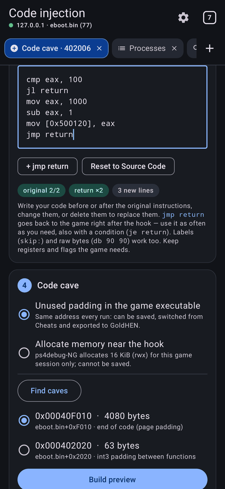
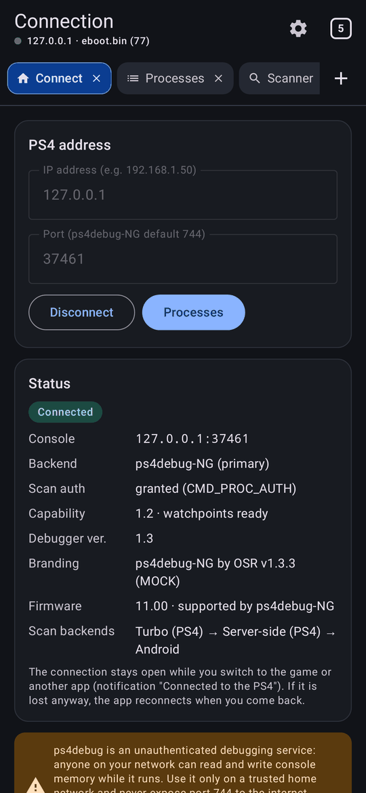
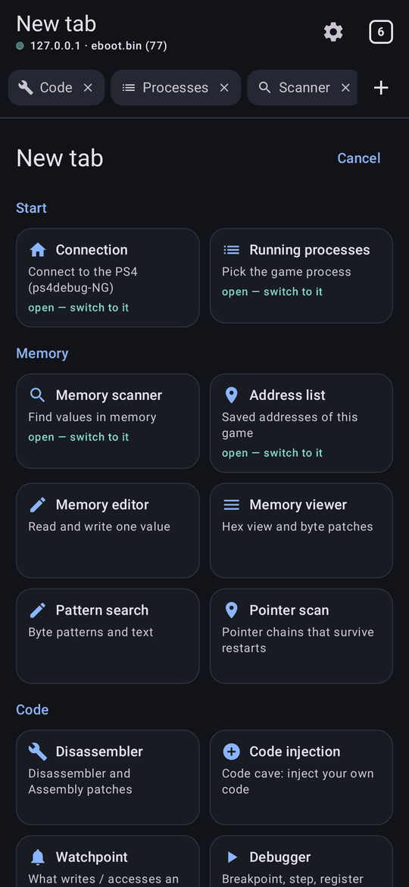
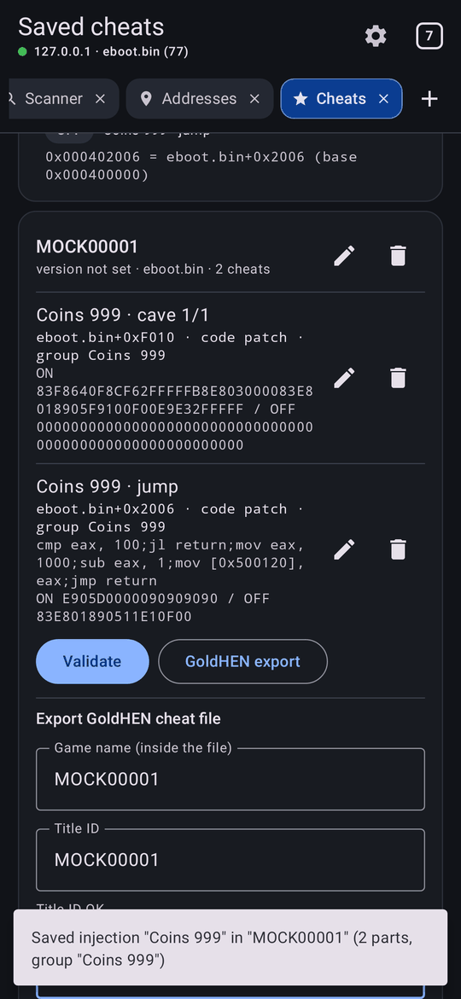
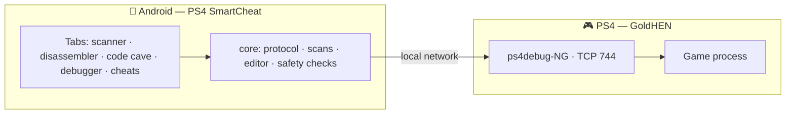

<div align="center">


# PS4 SmartCheat

**A memory scanner, disassembler and cheat workbench for your own jailbroken PlayStation 4 — running on your Android phone.**

[](https://github.com/Hm589158/ps4-SmartCheat/releases/latest)
[](https://github.com/Hm589158/ps4-SmartCheat/actions/workflows/ci.yml)
[](#firmware-support)
[](https://github.com/Pharaoh2k/ps4debug-NG)
[](#required-downloads)
[](LICENSE)

[Downloads](#required-downloads) · [Setup](#setup-in-5-steps) · [Features](#features) · [Firmware](#firmware-support) · [Status](#status) · [Build](#building-from-source) · [Credits](#credits-and-licenses)

</div>

---

PS4 SmartCheat connects over your local network to **ps4debug-NG** and turns the phone into a complete memory tool,
organised in **tabs like a browser**:
- **Find a value in seconds** with scans that run on the console, and edit it with confirmation and read-back.
- **Keep what you found** across game restarts, with module-relative addresses and pointer chains.
- **Find the code** that writes to an address, then patch it or inject your own code in a code cave.
- **Package it as a GoldHEN cheat** that you switch from the GoldHEN menu without the phone.

It is meant for offline games and homebrew on hardware you own.

## Required downloads

| | What | Where |
|:-:|---|---|
| 📱 | **PS4 SmartCheat** — the Android app (APK, Android 8.0+, phones and tablets) | **[Latest release](https://github.com/Hm589158/ps4-SmartCheat/releases/latest)** |
| 🎮 | **ps4debug-NG** — the debugger payload that runs on the PS4 | **[Official project](https://github.com/Pharaoh2k/ps4debug-NG)** · **[Releases](https://github.com/Pharaoh2k/ps4debug-NG/releases/latest)** |
| 🔓 | **GoldHEN** — homebrew enabler on the jailbroken console | [GoldHEN](https://github.com/GoldHEN/GoldHEN) |

> [!IMPORTANT]
> **ps4debug-NG is required.** It is the debugger the app is built and tested for: the app authenticates with it
> automatically and uses its Turbo scans, assembler and debugger. The classic ps4debug payload (for example
> [GoldHEN/ps4debug](https://github.com/GoldHEN/ps4debug)) only works in an untested compatibility mode and is not supported.

**The ps4debug-NG payload file.** Each ps4debug-NG release ships one ready-to-send `.bin` payload. At the time of
writing the latest is **v1.3.4**:
[`ps4debug-ng_v1.3.4_release_2026-11-05.bin`](https://github.com/Pharaoh2k/ps4debug-NG/releases/download/1.3.4/ps4debug-ng_v1.3.4_release_2026-11-05.bin)
(3.03 MB, SHA-256 `8bfe0507972718e6078778c5f9c44d84293197c0547239ab4227bdb351299b3e`). The file name changes with every
release, so check the [latest release](https://github.com/Pharaoh2k/ps4debug-NG/releases/latest) for newer versions.
You can also build it from source with the project's `build.sh`, which produces `ps4debug-ng.bin`.

## Setup in 5 steps

1. **Jailbreak and start GoldHEN** on the PS4 with the method for your firmware (any
   [firmware ps4debug-NG supports](#firmware-support), 5.05–14.02).
2. **Load ps4debug-NG.** Send the `.bin` to your jailbreak's payload loader. The ps4debug-NG README names ports
   **9020 or 9021**, depending on the jailbreak. Example from a computer on the same network:
   ```bash
   nc <PS4-IP> 9020 < ps4debug-ng_v1.3.4_release_2026-11-05.bin
   ```
   (or use your favourite payload sender app). The console shows **"ps4debug-NG v1.3.4 by Pharaoh2k"** when it is
   running and listening on port **744**.
3. **Start the game** you want to inspect (offline / single-player).
4. **Connect the app.** Phone on the same Wi-Fi/LAN → **Connect** tab → the PS4's local IP, port **744** →
   **Connect**. The app shows *ps4debug-NG*, *Scan auth: granted*, the firmware, and selects the running game
   automatically.
5. **Scan and edit.** **Scanner** tab → the value you see (e.g. ammo `30`) → **New scan**. Then change the value in
   the game → **Next scan**, until a few results remain. Tap a result → new value → **Write** → confirm. Tap **+** to
   keep it in the game's address list.

> [!TIP]
> The PS4's IP address is under *Settings → Network → View Connection Status*. If **Connect** fails, check that the
> ps4debug-NG notification appeared and run *Settings → Diagnostics*. Every tool is on the **+** (new tab) page; the
> **Guide** there covers each screen.

<div align="center">
<table>
  <tr>
    <td align="center"><br><sub><b>Turbo Scan on the PS4</b></sub></td>
    <td align="center"><br><sub><b>Tools in tabs</b></sub></td>
    <td align="center"><br><sub><b>Disassembler · ON/OFF patches</b></sub></td>
    <td align="center"><br><sub><b>Code caves</b></sub></td>
  </tr>
  <tr>
    <td align="center"><br><sub><b>Breakpoints · trace</b></sub></td>
    <td align="center"><br><sub><b>What writes / accesses</b></sub></td>
    <td align="center"><br><sub><b>Cheats · GoldHEN</b></sub></td>
    <td align="center"><br><sub><b>Pointer scan</b></sub></td>
  </tr>
</table>
<details><summary><b>More screens</b></summary><br>







<br><br>
</details>
<sub>Screenshots from the automated UI tests, which run against a simulated ps4debug-NG server (not a real PS4).</sub>
</div>

## Features

<table>
<tr><td width="50%" valign="top">

**🗂️ Tabs like a browser**
- Every tool opens in its own tab: two disassemblers at different addresses, a scan, the cheat library…
- Switching tabs keeps each tool's work. Open tabs are restored when the app starts again
- **+** opens any tool; links (*View memory*, *What writes?*) open a tab next to the current one
- Long-press and slide a tab to move it; the tab counter shows all tabs (reorder, close)
- One PS4 connection and one selected game shared by all tabs. Phones and tablets, light and dark theme

</td><td width="50%" valign="top">

**🔎 Fast scanning**
- **Turbo Scan** and **server-side scan** run on the PS4. The app picks them automatically and falls back to scanning on
  the phone ([benchmark](docs/PERFORMANCE.md))
- Int8 – Int64, Float, Double · exact, bigger/smaller, between, unknown initial, increased/decreased (by),
  changed/unchanged
- Byte-pattern (AOB, `??` wildcards) and text search
- Live progress, MiB/s and network traffic. Sessions resume after an app restart

</td></tr>
<tr><td valign="top">

**🛡️ Safe editing**
- Every write shows the current → new bytes, needs your confirmation, and is checked by reading it back
- Restore originals, confirmed **undo/redo**, freeze while connected
- Editing can be switched off for a read-only session; system processes can be blocked
- Nothing is ever re-applied automatically, not even after a reconnect or a game restart

</td><td valign="top">

**📌 Keep what you found**
- Per-game **address list** with live values, freeze and edit
- Addresses stored relative to the game executable survive restarts
- **Pointer scan** for values that move every run; candidates ranked by how often they survive restarts
- **Check after restart**: address list, pointers, value cheats and code patches; moved code is found again by its
  signature

</td></tr>
<tr><td valign="top">

**🧩 Assembly ON/OFF and code caves**
- **Disassembler** with addresses, `eboot.bin+offset`, bytes and read/write/branch markers; follow branches
- Type new instructions (`nop`, `mov eax, 999` …): the **PS4 assembles them** (ps4debug-NG's Keystone) at that address
- Whole instructions are replaced and NOP-padded; preview of ON/OFF bytes before anything is written
- **Code caves**: the replaced instructions appear as read-only **Source Code** and are copied into an editable
  **Target Code**. Write before, after or instead of them, with `jmp return` wherever you need it
  ([details](docs/CODE_CAVES.md))
- Building over a patch that is already ON is refused, so "off" is always the game's original code

</td><td valign="top">

**🔬 Debugger**
- **What writes / accesses** an address (hardware watchpoints): **Capture once** or monitor, with hit count, thread,
  registers and call stack. Every pause is resumed with a verified CONTINUE; results are saved for later
- **Execution breakpoints, single-step and register trace**: registers and callers when an instruction runs, or the
  next instructions with the registers each one changes. No game code is changed
- No root and no relay; needs ps4debug-NG **capability level 1.2** for watchpoints
  ([PR #1](https://github.com/Pharaoh2k/ps4debug-NG/pull/1)), checked before attaching ([details](docs/WATCHPOINTS.md))

</td></tr>
<tr><td valign="top">

**🎮 Cheats and GoldHEN**
- Cheat library with per-game profiles; value cheats, code patches and injections switch **ON/OFF** from it
- **GoldHEN export** with the official file names (`CUSA05294_01.25.json`, or `…_default.elf.json` for other
  processes; versions such as `1.25` become `01.25`)
- **Safety check before every export and switch.** Unsafe mods are left out with the reason:
  - "off" that is not original code;
  - cut or invalid instructions, or a hook that does not jump to its cave;
  - cave code that runs into padding or never returns;
  - conflicting mods.
- Import GoldHEN files: a mod is enabled only if memory matches its original bytes

</td><td valign="top">

**🔌 Connection and tools**
- Automatic authentication with ps4debug-NG, reconnect, keep-alive; stays connected while you switch to the game
- Game detection by title ID; the process list appears at once and finishes within a time limit
- Hex viewer with byte patches, diagnostics with error explanations, exportable event log
- Local network only by default, no telemetry, nothing sent anywhere else

</td></tr>
</table>

## Firmware support

PS4 SmartCheat works on **every firmware ps4debug-NG supports — 39 versions from 5.05 to 14.02**. The app has no
firmware-specific code: it only talks to ps4debug-NG, which does all the firmware-dependent work on the console. The
Connection screen shows the console's firmware and whether it is on this list.

| 5.xx | 6.xx | 7.xx | 8.xx | 9.xx | 10.xx | 11.xx | 12.xx | 13.xx | 14.xx |
|---|---|---|---|---|---|---|---|---|---|
| 5.05 · 5.07 | 6.71 · 6.72 | 7.00 · 7.02 · 7.50 · 7.51 · 7.55 | 8.00 · 8.03 · 8.50 · 8.52 | 9.00 · 9.03 · 9.04 · 9.50 · 9.51 · 9.60 | 10.00 · 10.01 · 10.50 · 10.70 · 10.71 | 11.00 · 11.02 · 11.50 · 11.52 | 12.00 · 12.02 · 12.50 · 12.52 | 13.00 · 13.02 · 13.04 · 13.50 · 13.52 | 14.00 · 14.02 |

The list is ps4debug-NG's own ("Supported firmwares" in its README); hardware results per firmware are collected in
[docs/COMPATIBILITY.md](docs/COMPATIBILITY.md).

## Status

**Beta.** Feature-complete; every commit passes 267 JVM tests and the end-to-end UI journeys.

| What | Result |
|---|---|
| Connect, authentication, process list, Turbo Scan, next scans, writing a value in a game | **Reported working on a real PS4** by the project owner (FW 11.00, GoldHEN, ps4debug-NG 1.3.3) |
| Address list, pointer scan, pattern search, byte patches, undo/redo, GoldHEN import/export, diagnostics, tabs | Verified end to end against the simulated server. **Hardware reports wanted** |
| Assembly ON/OFF, code caves, assembler, reference search, watchpoints, breakpoints and trace, session check | Built from the ps4debug-NG **1.3.4** source and verified against the simulated server. **Hardware reports wanted** |
| Other firmware versions supported by ps4debug-NG | Supported (no firmware-specific code). **Hardware reports wanted** |
| Classic / GoldHEN ps4debug | Not supported (untested compatibility mode only) |

Tested something? Please file a **[hardware test report](https://github.com/Hm589158/ps4-SmartCheat/issues/new?template=hardware_report.yml)**.

**Releases.** Every green CI run on `main` publishes the next version (v1.0.1, v1.0.2, …) as the single
[latest release](https://github.com/Hm589158/ps4-SmartCheat/releases/latest): one APK, signed with the project's
release key (package `com.ps4smartcheat.app`), which updates the previous version in place
([signing](docs/RELEASE_SIGNING.md)). Release notes come from the [changelog](CHANGELOG.md).

## How it works



**Turbo Scan** keeps the candidates on the console, so only the matches travel over Wi-Fi: kilobytes instead of tens of
megabytes per scan. Every protocol command the app uses was checked against the ps4debug-NG source and is documented in
[docs/PROTOCOL.md](docs/PROTOCOL.md). ps4debug has no authentication, so use it only on a trusted home network. The app
refuses non-local addresses by default and sends nothing anywhere else.

## Building from source

```bash
cd android
./gradlew :core:test                      # 267 JVM tests (no Android SDK needed)
./gradlew :app:testDebugUnitTest          # end-to-end UI journeys (Android SDK)
./gradlew :app:assembleDebug              # debug APK
./gradlew :mockserver:run --args="7440"   # simulated PS4 to try the app without a console
```

JDK 17+, Android SDK for `:app`. Gradle 8.14.3, AGP 8.11.1, Kotlin 2.2.21, Compose BOM 2025.08.00, min SDK 26,
target SDK 36.

CI runs on every push:
- core and mock-server tests and the scan benchmark;
- UI journeys, with screenshots on the [`ci-screenshots`](https://github.com/Hm589158/ps4-SmartCheat/tree/ci-screenshots) branch;
- lint and the APK build.

<details>
<summary><b>Project layout</b></summary>

```
android/core/        protocol client, scanners, editor, disassembler, code caves, debugger, cheats, tabs (pure Kotlin)
android/mockserver/  independent ps4debug-NG emulation (with a small x86 interpreter) for tests and manual trials
android/app/         Jetpack Compose UI and end-to-end tests
docs/                protocol, architecture, testing, performance, compatibility, code caves, watchpoints, signing
```
</details>

## Documentation

[Changelog](CHANGELOG.md) · [Protocol](docs/PROTOCOL.md) · [Architecture](docs/ARCHITECTURE.md) · [Testing](docs/TESTING.md) ·
[Performance](docs/PERFORMANCE.md) · [Compatibility](docs/COMPATIBILITY.md) · [Code caves](docs/CODE_CAVES.md) ·
[Watchpoints](docs/WATCHPOINTS.md) · [Roadmap](docs/ROADMAP.md) · [Release signing](docs/RELEASE_SIGNING.md) ·
[Contributing](CONTRIBUTING.md) · [Security](SECURITY.md)

## Credits and licenses

- **[ps4debug-NG](https://github.com/Pharaoh2k/ps4debug-NG)** — the debugger payload this app depends on. It is a
  clean-room rewrite by **OSR (OpenSourcereR)**, published by **Pharaoh2k**, and licensed under **GPL-3.0**. It builds on
  **jogolden**'s original [ps4debug](https://github.com/jogolden/ps4debug) and on **Ctn & SiSTRo**'s ps4debug v1.1.19.
- [PS4CheaterNeo](https://github.com/avan06/PS4CheaterNeo) by **avan06**: client reference and GoldHEN cheat format.
- [GoldHEN](https://github.com/GoldHEN/GoldHEN) and its [cheat repository](https://github.com/GoldHEN/GoldHEN_Cheat_Repository)
  (file layout checked against its files).
- [iced-x86](https://github.com/icedland/iced) (MIT) — x86-64 decoder used by the disassembler.

**This repository does not bundle or redistribute ps4debug-NG.** Download it from its official releases. If you
redistribute it, follow its GPL-3.0 terms:
- keep the license and attribution, including the credit to the original authors;
- provide the complete corresponding source for any binary you distribute, modified or not.

PS4 SmartCheat itself is released under the [GNU General Public License v3.0](LICENSE) (GPL-3.0). PlayStation and PS4
are trademarks of Sony Interactive Entertainment. This project is not affiliated with or endorsed by Sony.
